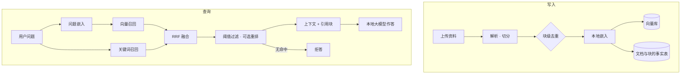

# 电商 RAG 问答

> 上传商品资料，基于知识库回答并标注引用；检索不到就明确拒答，不编造。


-000000)

## 这个项目解决什么

电商客服的知识高度碎片化：尺码怎么选、面料怎么洗、色差怎么解释、售后怎么走。这些答案散在详情页、内部文档和聊天记录里，客服每次都要翻。

这个项目把资料收进一个可检索的知识库：文档先过摄取流水线，问题走混合检索，答案带引用块；如果检索不到相关内容，直接说明"没有找到依据"，而不是凭模型记忆编一个。

## 功能概览

| 能力 | 说明 |
| --- | --- |
| 文档摄取 | txt / md / pdf / docx 上传，解析 → 切分 → 块级去重 → 嵌入 → 入库，状态从处理中到就绪或失败，失败原因落库 |
| 幂等重导 | 按块内容指纹判重，重复上传不会产生重复向量 |
| 混合检索 | 向量召回 + 关键词 BM25，用 RRF 融合两路候选，再做距离与相对阈值过滤 |
| 可加重排 | 特征重排（距离、词面重叠、标题命中）默认关闭，可按需开启 |
| 权限隔离 | 所有检索与写入按 user_id 过滤，可按分类再收窄；越权请求不命中任何内容 |
| 引用溯源 | 回答附带命中的资料块，能对上是哪一段 |
| 拒答 | 无命中或相关度不足时明确说明没有依据 |
| 知识管理 API | 文档上传、列表、详情、删除、重建索引、检索、问答、索引统计、健康检查 |
| 界面 | Streamlit 多页：首页、问答、知识库管理 |
| 评测脚本 | 自带标注集与评测脚本，改动检索或阈值后可直接重跑对比 |

## 架构



## 技术栈

| 层 | 选型 |
| --- | --- |
| 后端 | FastAPI + Pydantic，统一错误信封与请求 ID |
| 前端 | Streamlit 多页应用 |
| 检索 | 向量（Chroma）+ BM25，RRF 融合 |
| 嵌入与对话 | 本地 Ollama（默认）；DeepSeek 为可选备选 |
| 存储 | SQLite（文档与块的事实源）+ Chroma（向量） |
| 评测 | 自带标注集与评测脚本，输出召回与拒答指标 |

## 目录结构

```
.
├── app/                # Streamlit 界面与核心服务：config / db / document_loader /
│                       # knowledge / reranker / llm / chat / ui / Home
├── server/             # FastAPI：main / middleware / rate_limit / schemas / routers
│   └── routers/        # health / documents / retrieval / admin
├── scripts/            # init_db.py 建表、reindex.py 重建索引
├── evals/              # 标注集与评测脚本（运行时数据不入库）
├── tests/              # 摄取、删除一致性、权限隔离、重排开关、API
├── data/               # 种子知识文档
└── requirements.txt / Dockerfile / start.ps1
```

## 快速开始

前置：Ollama 已运行，并拉取嵌入与对话模型。

```powershell
ollama pull qwen3-embedding:4b
ollama pull qwen3.5:9b
```

```powershell
python -m pip install -r requirements.txt
copy .env.example .env
python scripts/init_db.py
python scripts/reindex.py
python -m uvicorn server.main:app --port 8002
python -m streamlit run app/Home.py --server.port 8512
```

API 文档：`http://localhost:8002/docs`；界面：`http://localhost:8512`。也可以直接运行 `.\start.ps1`。

## 主要接口

| 方法 | 路径 | 说明 |
| --- | --- | --- |
| GET | `/health` | 存储、向量库与模型状态 |
| POST | `/api/v1/documents/upload` | 上传资料（可带标题、分类、标签） |
| GET | `/api/v1/documents` | 文档列表（状态、版本、块数） |
| GET / DELETE | `/api/v1/documents/{id}` | 文档详情 / 删除（事实表与向量库同步） |
| POST | `/api/v1/documents/rebuild` | 以事实表为准重建向量库 |
| POST | `/api/v1/retrieve` | 纯检索，返回候选块与分数 |
| POST | `/api/v1/ask` | 问答，返回答案与引用块 |
| GET | `/api/v1/admin/stats` | 文档与块统计、两库一致性 |

## 设计取舍

- **事实源只有一个**：文档与块以关系表为准，向量库随时可重建；顺序反了就会出现"查得到却不存在"。
- **拒答是功能而不是缺陷**：阈值的意义是宁可说没有，也不要给出看起来合理的错答案。
- **开关由评测决定**：混合检索默认开、LLM 重排默认关，理由都能在评测脚本里复现，而不是拍脑袋。
- **权限在检索层**：user_id 过滤同时落在向量元数据与关系表查询上，越权请求拿不到任何块。
- **删除要一致**：删除时两库同步，并做二次校验，避免留下"幽灵块"。

## 已知限制

- 多用户按 user_id 隔离，无登录鉴权，适合本机或内网；公网部署需自行加认证。
- 评测集是小样本标注，换更大语料时阈值需要重新标定。
- 限流为进程内滑动窗口，多实例部署应换成集中式存储。
- 云端模型通道需要自备密钥，默认路径为全本地。
